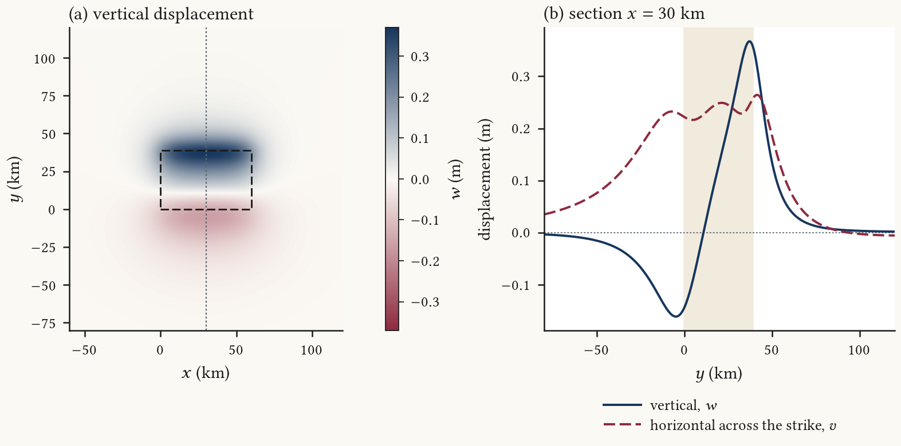

<!-- Author: Dr. Denys Dutykh (Mathematics Department, Khalifa University of Science and Technology, Abu Dhabi, UAE) -->

# Okada: surface displacements of a rectangular fault in an elastic half-space (Okada, 1985)



Surface displacements computed by `OkadaSol.m` for a sample thrust fault: a rectangle 60 km long and 40 km wide,
dipping at 13°, whose deeper edge lies at a depth of 20 km along the x-axis (its shallower edge at 11 km), with a slip
of 1 m and the rake 90° (pure dip slip). Panel (a) shows the vertical displacement w on one colour scale from −0.37 m
(wine) to 0.37 m (navy), with the surface projection of the fault (dashed) and the section of panel (b) (dotted): the
ground rises by up to 0.367 m above the shallow part of the fault and sinks by up to 0.161 m beyond its deep edge.
Panel (b) shows, along the section x = 30 km across the middle of the fault, the vertical displacement and the
horizontal displacement across the strike, the projection of the fault being shaded. All displacements are
proportional to the slip.

Okada is a MATLAB function, `OkadaSol.m`, which also runs in GNU Octave, that computes the static displacements of the
surface of a homogeneous elastic half-space caused by the slip on a rectangular fault, by the closed-form solution of
Okada (1985). This exact solution is often used to build the co-seismic displacements caused by an underwater
earthquake, from which an initial condition for codes of tsunami propagation is then constructed; the chapter of
Dutykh and Dias (2007), cited below, discusses this construction and the generation of tsunamis by a moving bottom.
The function covers shear faults (strike slip and dip slip, combined by the rake angle), not tensile ones.

## The problem

The crust is a homogeneous and isotropic elastic half-space, whose Lamé coefficients the function computes from the
speeds of the P and S waves and the density:

```text
vp = 6000 m/s,    vs = 3400 m/s,    rho = 2700 kg/m³,      mu = vs² rho,    lambda = vp² rho − 2 mu.
```

A rectangular fault of length L along its strike and of width W along its dip, inclined at the dip angle δ, slips by
U in the direction given by the rake angle θ. The coordinates x (along the strike) and y (across it) are measured from
the point above the corner (x0, y0) of the fault that starts its deeper edge, at the depth d, and the fault extends
from that corner along the strike over L and up the dip over W. In the notation of Okada, each displacement at the
surface point (x, y) combines the values at the four corners of the fault,

```text
f(ξ, η) ‖ = f(x, p) − f(x, p − W) − f(x − L, p) + f(x − L, p − W),
p = y cos δ + d sin δ,      q = y sin δ − d cos δ,
```

of the closed-form expressions of his paper, the strike-slip part being weighted by U cos θ and the dip-slip part by
U sin θ. All lengths are in metres and all angles in radians.

## Quick start

From the folder `MatlabScript/`, in MATLAB or GNU Octave:

```matlab
global delta phi L W
delta = 13*pi/180;  phi = 0;  L = 60e3;  W = 40e3;   % dip and strike (radians), length and width (m)
[X, Y] = meshgrid(linspace(-60e3, 120e3, 361), linspace(-80e3, 120e3, 401));
[u, v, w] = OkadaSol(X, Y, 0, 0, 20e3, 1.0, pi/2);    % corner (0, 0), depth 20 km, slip 1 m, rake 90°
```

The function returns the displacements `u`, `v` and `w` of the surface along x, along y and upwards, in metres, at
the points `(X, Y)`, which may be arrays of any shape; its arguments are the points, the corner `(x0, y0)` of the
fault, its depth `d`, the slip `U` and the rake `theta`. The dip, the strike, the length and the width of the fault
are passed through the global variables `delta`, `phi`, `L` and `W`, which must be declared global and set before the
call. This example, the fault of the figure, takes 0.15 s for its 144 761 points with GNU Octave 11.1. The formulas
divide by cos δ, so that a vertical fault cannot be computed as such: at δ = 90° exactly the function returns wrong
values (no horizontal displacement and a vertical displacement of 4.4 m for a slip of 1 m, in a test), while a dip
slightly below, such as 89.99°, gives sensible ones.

## Contents

The folder `MatlabScript/` holds the function `OkadaSol.m`. The folder `docs/figures/` holds the two scripts that make
the figure of this page: `okada_readme_data.m` (GNU Octave or MATLAB) computes the displacements of the sample fault
and writes them, and `plot_readme_figure.py` (Python 3 with NumPy and Matplotlib, and the style file beside it) draws
them. Both are run from `docs/figures/`, in this order. The function is also distributed on the File Exchange of MATLAB
Central as [Okada solution](https://www.mathworks.com/matlabcentral/fileexchange/39819-okada-solution), and a port to
FreeFem++ by Georges Sadaka and Denys Dutykh, `Common_files/OkadaSol.edp`, is part of the repository TsunamiTutorial:

https://github.com/dutykh/TsunamiTutorial

## Requirements

MATLAB or GNU Octave (tested with Octave 11.1); no toolbox is needed.

## How to cite

If you use this code, please cite the paper of Okada, whose solution it computes:

Y. Okada, Surface deformation due to shear and tensile faults in a half-space, Bulletin of the Seismological Society
of America 75, 1135–1154 (1985).

https://doi.org/10.1785/bssa0750041135

```bibtex
@article{Okada1985,
  author = {Okada, Yoshimitsu},
  title = {Surface Deformation Due to Shear and Tensile Faults in a Half-Space},
  journal = {Bulletin of the Seismological Society of America},
  year = 1985,
  volume = {75},
  number = {4},
  pages = {1135--1154},
  doi = {10.1785/bssa0750041135}
}
```

The construction of tsunami initial conditions from such displacements is discussed in

D. Dutykh and F. Dias, Water waves generated by a moving bottom, in Tsunami and Nonlinear Waves (A. Kundu, editor),
Springer, Berlin, Heidelberg, 65–95 (2007).

https://doi.org/10.1007/978-3-540-71256-5_4

```bibtex
@incollection{Dutykh2006,
  author = {Dutykh, Denys and Dias, Fr{\'e}d{\'e}ric},
  editor = {Kundu, A.},
  title = {Water Waves Generated by a Moving Bottom},
  booktitle = {Tsunami and {{Nonlinear Waves}}},
  year = 2007,
  pages = {65--95},
  publisher = {Springer Berlin Heidelberg},
  address = {Berlin, Heidelberg},
  doi = {10.1007/978-3-540-71256-5_4}
}
```

The button "Cite this repository" in the right-hand column of this page gives the paper of Okada, read from
`CITATION.cff`, which also lists the chapter. A free copy of the chapter is kept by HAL:

https://hal.science/hal-00115875/

## Licence

MIT licence (see `LICENSE`).

## Author

Denys Dutykh (Mathematics Department, Khalifa University of Science and Technology, Abu Dhabi).

https://www.denys-dutykh.com/
